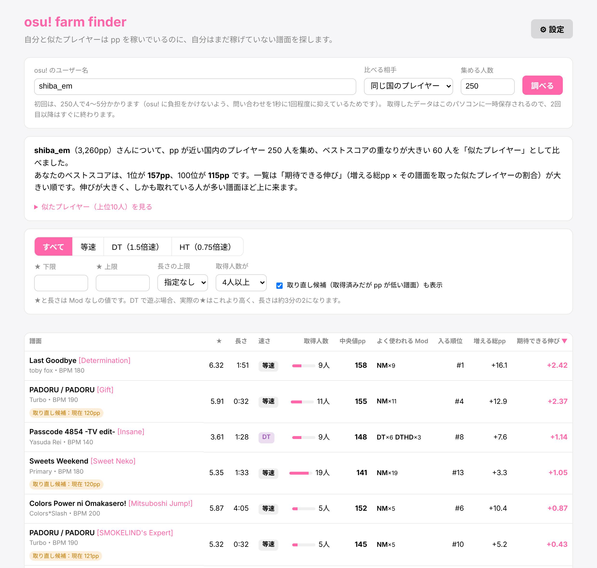
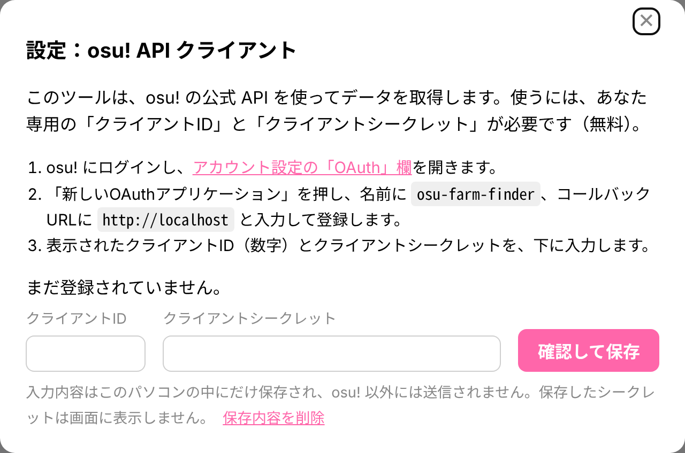
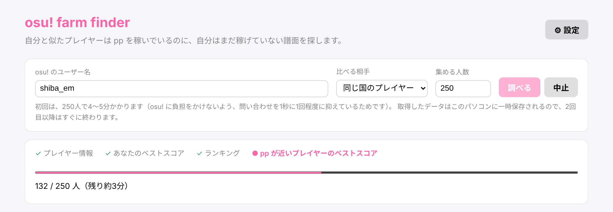
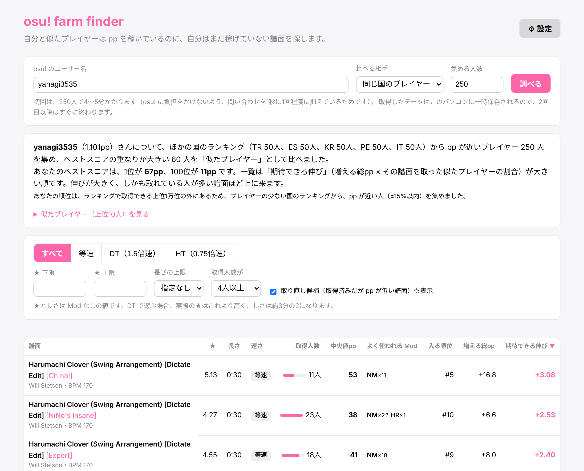
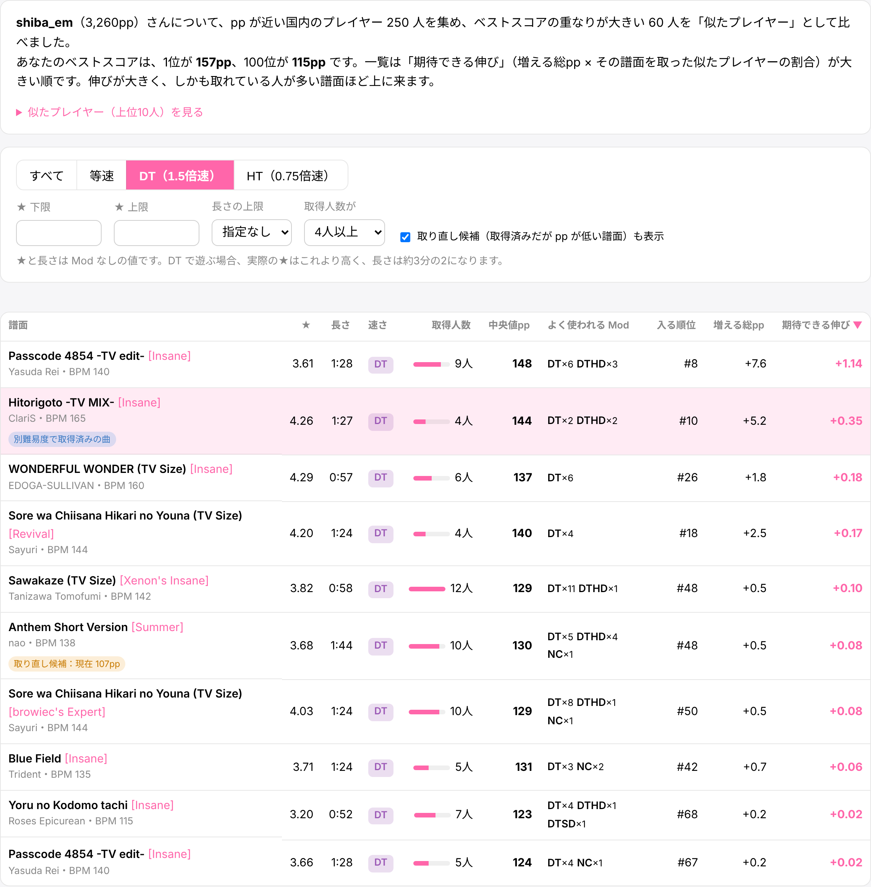

# osu! farm finder

[日本語](README.md) ｜ English

A tool for osu! (the rhythm game) that finds **maps where players similar to you have earned a lot of pp (performance points), but you have not yet**.



<sub>The screenshots show real results (the user interface is in Japanese). Beatmap cover images are hidden in the README screenshots.</sub>

---

## Contents

- [What it does](#what-it-does)
- [How it works and why it is safe](#how-it-works-and-why-it-is-safe)
- [Requirements](#requirements)
- [Setup 1: Install Node.js](#setup-1-install-nodejs)
- [Setup 2: Create an osu! API client](#setup-2-create-an-osu-api-client)
- [Usage](#usage)
- [Command-line options](#command-line-options)
- [Stored data and how to delete it](#stored-data-and-how-to-delete-it)
- [Troubleshooting](#troubleshooting)
- [Limitations](#limitations)
- [License](#license)

---

## What it does

When you enter a username, the tool builds a list of recommended maps in three steps:

1. It collects a few hundred players whose total pp is close to yours, from the osu! rankings (your country or worldwide). If you are ranked below the range the API provides (top 10,000), it collects players with similar pp from the rankings of countries with fewer players (see [Players outside the top 10,000](#players-outside-the-top-10000)).
2. Among them, it picks the players whose top scores overlap most with yours as "similar players".
3. It lists maps that appear often in the similar players' top scores but not in yours. For each map it shows the median pp they earned and the mods (game modifiers, for example DT = 1.5× speed) they commonly used.

## How it works and why it is safe

- This is a **small web app that runs only on your own computer**. When started, it runs a local server and you use it in your browser at `http://localhost:3000`.
- Data comes from the official **osu! API (version 2)**. To use the API, each user needs their own "client ID" and "client secret" (like an ID and password for the API). They are free to create.
- Your client ID and secret are **stored only on your computer** and are sent only to osu!. They are never sent to the author or any third party. The saved secret is never shown on screen.
- The local server accepts connections only from your own computer. Other computers and other websites cannot control it.
- To avoid putting load on osu!'s servers, the tool sends **about one API request per second**. Collecting data for many players therefore takes a few minutes.

## Requirements

| Item | Notes |
|---|---|
| A computer | Windows, macOS or Linux |
| Node.js 18 or newer | Free software that runs JavaScript on your computer |
| An osu! account | Needed to create an API client |
| Internet connection | Used to fetch osu! data and to download the tool |

## Setup 1: Install Node.js

1. Download and install the "LTS" (long-term support) version from the [Node.js website](https://nodejs.org/).
   - On Windows you can also run `winget install OpenJS.NodeJS.LTS` in a terminal.
   - If you want to switch between several Node.js versions, use a version manager: [nvm](https://github.com/nvm-sh/nvm) on macOS/Linux, or [nvm-windows](https://github.com/coreybutler/nvm-windows) on Windows. With nvm-windows, install it with `winget install CoreyButler.NVMforWindows`, open a new terminal, then run `nvm install lts` and `nvm use lts` (some versions require a terminal opened as administrator).
2. After installing, **close all open terminals and open a new one**. Terminals that were already open will not see the new installation.
3. Check the installation by running:

   ```
   node -v
   ```

   You are ready if it prints `v18.0.0` or higher (for example `v22.11.0`).

## Setup 2: Create an osu! API client

1. Log in to the osu! website and open [account settings](https://osu.ppy.sh/home/account/edit).
2. In the "OAuth" section near the bottom, click "New OAuth Application".
3. Fill in the form and register:
   - **Application name**: any name you will recognize (for example `osu-farm-finder`)
   - **Application callback URL**: `http://localhost` (this tool does not use it, but the field is required)
4. Your **client ID** (a number) and **client secret** (a long string; click "show" to see it) are displayed. Keep this page open for the next step.

> Treat the client secret like a password. Do not share it or publish it online. If it leaks, you can reset it on the same page.

## Usage

### 1. Start the tool

Run this in a terminal:

```
npx github:s-shibasaki/osu-farm-finder
```

- The first time, npx may ask `Ok to proceed? (y)`. Type `y` and press Enter.
- When it starts, it prints `osu-farm-finder is running: http://localhost:3000` and opens your browser. If the browser does not open, enter that URL manually.
- Keep the terminal open while you use the tool. Closing the terminal stops the tool.

### 2. Register your API client (first time only)

1. On first start, the settings dialog ("設定：osu! API クライアント") opens automatically. You can open it later with the "⚙ 設定" (Settings) button in the top right.
2. Enter the client ID and client secret from [Setup 2](#setup-2-create-an-osu-api-client) and click "確認して保存" (Verify and save). The tool checks them with osu! before saving.
3. When "登録済みです" (Registered) appears, you are done. Close the dialog with "✕". You do not need to enter them again.



### 3. Find recommended maps

1. Enter the player's name in "osu! のユーザー名" (osu! username). The last name you used is filled in automatically next time.
2. In "比べる相手" (Compare with), choose players from the same country (同じ国のプレイヤー) or worldwide (世界のプレイヤー).
3. In "集める人数" (Number of players), set how many players with similar pp to collect (20–1000, default 250). More players give more stable results but take longer the first time.
4. Click "調べる" (Search). Progress and an estimated remaining time are shown. Click "中止" (Cancel) to stop.
5. When collection finishes, the recommendation list appears.



- Because requests are limited to about one per second, the first run takes 4–5 minutes for 250 players.
- Collected data is cached on your computer, so running again with the same settings is fast. If you cancel, the data collected so far is kept and the next run continues from there.
- Cache lifetimes: other players' top scores 3 days, rankings 1 day, your own top scores 10 minutes. Expired data is fetched again on the next run.
- Reloading the browser page keeps the progress and results (until the tool is stopped).

### Players outside the top 10,000

The osu! API provides rankings only down to rank 10,000. In Japan, rank 10,000 is about 3,200pp, so players below that cannot be compared with players from the Japanese ranking.

When the player is ranked below 10,000 in the selected ranking (country or worldwide), the tool automatically switches to this method:

1. Starting with the countries with the most players, it checks the pp at rank 10,000 of each country's ranking. In countries with fewer players, that pp is low, so low-pp players are still listed.
2. In countries whose ranking reaches your pp, it finds the page listing players within ±15% of your pp and collects them.
3. To avoid bias toward one country's taste, at most one fifth of the players come from a single country. Only if there are still not enough players is this limit exceeded.

In this case you are compared with players from other countries. The summary above the list shows which countries the players came from. It takes about as long as the normal method.

Example for a player ranked about 37,000th in Japan (about 1,100pp). Players were collected 50 each from the rankings of Turkey, Spain, South Korea, Peru and Italy.



### 4. Filter and sort the list

| Control | What it does |
|---|---|
| "すべて／等速／DT／HT" (All / Normal speed / DT / HT) | Filters by the speed at which similar players earned the pp |
| "★ 下限" / "★ 上限" (Min / max stars) | Filters by star rating (without mods) |
| "長さの上限" (Max length) | Filters by song length (without mods) |
| "取得人数が○人以上" (At least N players) | Shows only maps that at least N similar players have in their top scores. Higher values give more reliable picks. |
| "取り直し候補も表示" (Show retry candidates) | Uncheck to hide maps that are already in your top scores |
| Column headers (★, length, players, median pp, rank if added, total pp gain, expected gain) | Click to sort; click again to reverse |

Example filtered to DT (1.5× speed):



### How to read the list

| Column | Meaning |
|---|---|
| 譜面 (Map) | Song title and difficulty name; links to the osu! beatmap page. "取り直し候補" (Retry candidate) means the map is in your top scores but your pp is well below similar players' (your current pp is shown). "別難易度で取得済みの曲" (Song already in your top) means another difficulty of the same song is in your top scores. |
| ★ | Star rating without mods. With DT the actual difficulty is higher. |
| 長さ (Length) | Song length without mods |
| 速さ (Speed) | The speed at which similar players earned pp: normal (等速), DT (1.5×) or HT (0.75×), counted separately |
| 取得人数 (Players) | How many similar players have this map in their top scores |
| 中央値pp (Median pp) | Median pp those players earned. Hover to see the minimum and maximum. |
| よく使われる Mod (Common mods) | Mod combinations used and how many players used them (NM = no mod) |
| 入る順位 (Rank if added) | Where a score with the median pp would land in your top scores |
| 増える総pp (Total pp gain) | How much your total pp would rise with a score worth the median pp (see step 5 below). Retry candidates gain less than new maps at the same rank, because the new score replaces your current one. |
| 期待できる伸び (Expected gain) | Total pp gain multiplied by the share of similar players who have this map (players ÷ number of similar players). It reflects both how much you would gain and how likely you are to get it. |

The list is first sorted by "期待できる伸び" (Expected gain), largest first: maps that would add a lot of pp and that many similar players have managed to get come first.

The list is not sorted by total pp gain alone, because that puts high-star maps taken by only a few players at the top. Those are maps where only a few similar players earned high pp, so you are less likely to get them. To focus on the size of the gain, click the "増える総pp" (Total pp gain) header.

#### How the recommendations are calculated

1. For each collected player, score how much their top scores overlap with yours (same difficulty = 1 point, another difficulty of the same song = 0.3 points).
2. The 60 players with the highest scores are the "similar players".
3. Count the maps in the similar players' top scores separately for each speed (normal, DT, HT). Maps taken by at least 4 players (adjustable) are listed.
4. Maps already in your top scores are kept as "retry candidates" only if your pp is below 85% of the similar players' median.
5. "Total pp gain" follows how osu! calculates total pp: your top scores are sorted by pp, and the n-th score counts for its pp × 0.95^(n−1). The tool shows the difference in that sum with and without a score worth the median pp. osu! counts only your best score per map, so if you already have a score on the map, the new score replaces it. The small bonus for the number of maps played does not change when one score is added, so it is left out.
6. "Expected gain" is the total pp gain from step 5 multiplied by the share of similar players who have the map (players ÷ number of similar players).

### 5. Stop the tool

In the terminal where the tool is running, press `Ctrl` + `C`. You can close the browser tab.

## Command-line options

Add these after the start command, for example `npx github:s-shibasaki/osu-farm-finder --port=4000`.

| Option | Description |
|---|---|
| `--port=NUMBER` | Port number for the local page. Default is 3000; if it is in use, 3001, 3002, … are tried in order. |
| `--no-open` | Do not open the browser automatically |

## Stored data and how to delete it

| Location | Contents |
|---|---|
| Windows: `C:\Users\<user>\.osu-farm-finder\config.json`<br>macOS/Linux: `~/.osu-farm-finder/config.json` | Client ID and client secret |
| Windows: `C:\Users\<user>\.osu-farm-finder\cache\`<br>macOS/Linux: `~/.osu-farm-finder/cache/` | Cached osu! data (rankings and top scores), roughly a few tens of MB for 250 players |

- To delete the client ID and secret, click "保存内容を削除" (Delete saved settings) in the settings dialog. To delete cached data, click "一時保存データを削除" (Delete cached data) at the bottom of the page. You can also delete the whole `.osu-farm-finder` folder.
- On macOS/Linux the config file is readable only by your user.
- You can change the storage location with the `OSU_FARM_FINDER_HOME` environment variable.

## Troubleshooting

| Symptom | Cause and fix |
|---|---|
| `node` or `npx` is not found | Node.js is not installed, or the terminal was opened before installation. Follow [Setup 1](#setup-1-install-nodejs) and open a new terminal. |
| PowerShell says running scripts is disabled on this system | PowerShell's execution policy blocks the `npx` script. Use `npx.cmd` instead, for example `npx.cmd github:s-shibasaki/osu-farm-finder`. |
| An old version opens after a new one was released | npx may reuse a previously downloaded version. Run `npx --yes github:s-shibasaki/osu-farm-finder#main` to fetch the latest. |
| "Node.js 18 or newer" is printed and the tool stops | Your Node.js is too old. Install the current LTS version. |
| A `git` error appears while downloading | Some environments need Git to download from GitHub. Install it from [git-scm.com](https://git-scm.com/) and try again. |
| The settings dialog says the client ID or secret is wrong | Check both values, including leading or trailing spaces, and enter them again. |
| The player is not found | Check the spelling of the username. |
| The page says not enough players with similar pp were found in any country | The player's pp is very low (tens to a few hundred), so almost no country ranking lists players with similar pp. Try again after earning more pp. |
| The page says osu! is busy | osu! is under load or too many requests were sent. Wait a while and try again; collected data is kept. |

## Limitations

- The osu! API returns rankings only down to **rank 10,000**. Players ranked below that are compared with players collected from the rankings of countries with fewer players (see [Players outside the top 10,000](#players-outside-the-top-10000)), so they are compared with players from other countries.
- Similarity is based only on top scores (your highest-pp plays). Lower-pp scores outside the top list are not considered.

## For developers

```
git clone https://github.com/s-shibasaki/osu-farm-finder.git
cd osu-farm-finder
npm start      # start the tool
npm test       # run the automated tests
```

The tool uses only Node.js built-in modules, so `npm install` is not needed.

## License

[MIT License](LICENSE).

This is a personal project and is not affiliated with ppy Pty Ltd (the operator of osu!). Please follow the osu! API [terms of use](https://osu.ppy.sh/docs/#terms-of-use).
