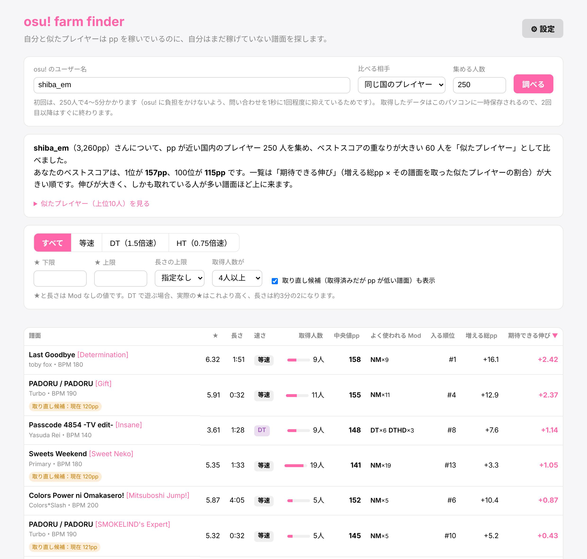
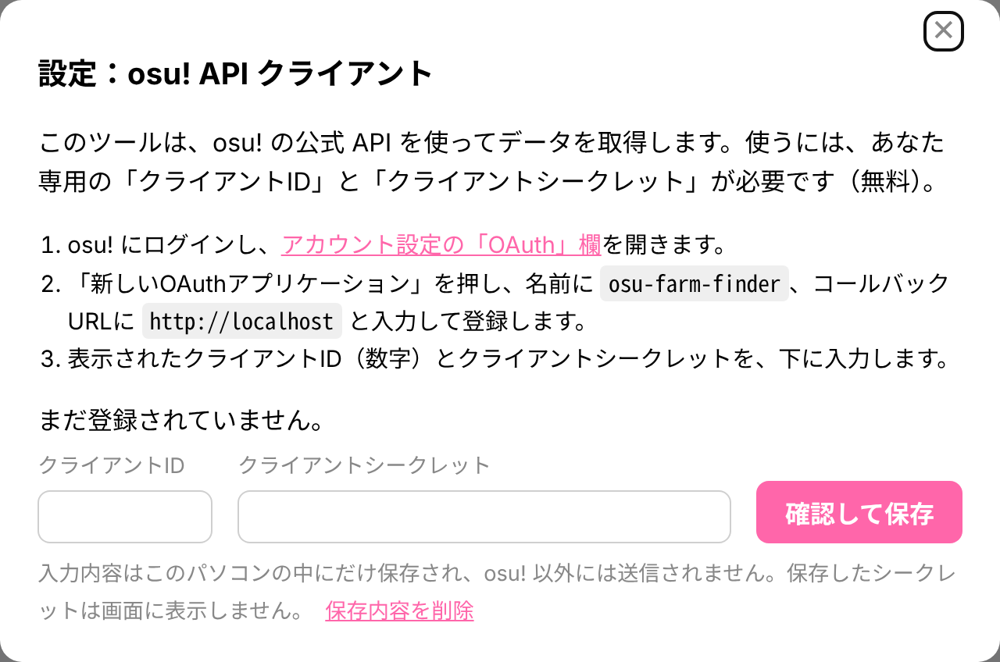
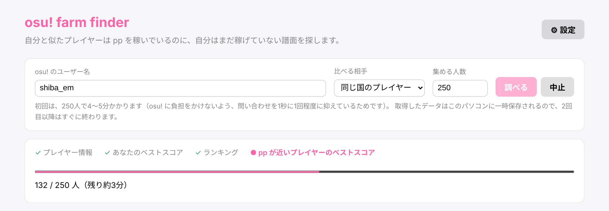
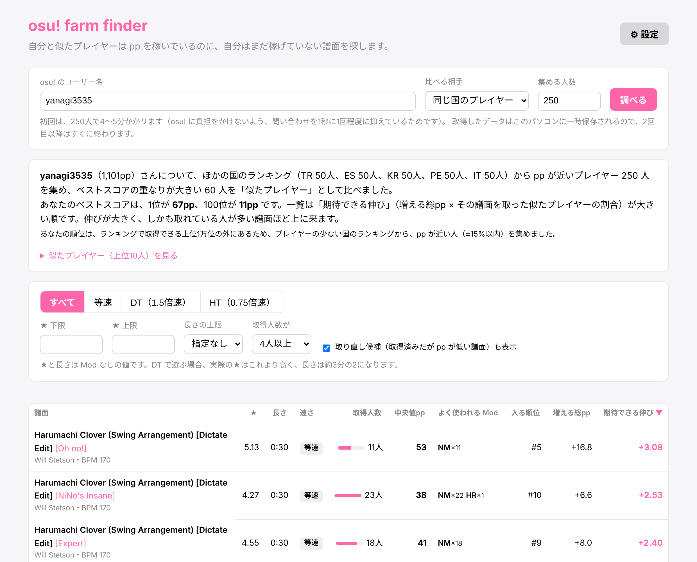
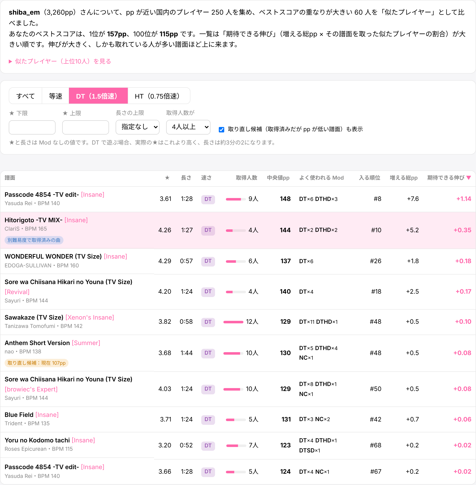

# osu! farm finder

日本語 ｜ [English](README.en.md)

osu!（リズムゲーム）で、**自分と実力や好みが近いプレイヤーはよく pp（パフォーマンスポイント）を稼いでいるのに、自分はまだ稼げていない譜面**を探すツールです。



<sub>画面は実際の表示例です（README の画像では、譜面のジャケット画像を非表示にしています）。</sub>

---

## 目次

- [このツールでできること](#このツールでできること)
- [仕組みと安全性](#仕組みと安全性)
- [必要なもの](#必要なもの)
- [準備1：Node.js をインストールする](#準備1nodejs-をインストールする)
- [準備2：osu! の API クライアントを発行する](#準備2osu-の-api-クライアントを発行する)
- [使い方](#使い方)
- [起動時のオプション](#起動時のオプション)
- [保存されるデータと削除方法](#保存されるデータと削除方法)
- [うまく動かないとき](#うまく動かないとき)
- [制約と開発状況](#制約と開発状況)
- [ライセンス](#ライセンス)

---

## このツールでできること

ユーザー名を入力すると、次の手順でおすすめの譜面を一覧にします。

1. あなたと pp が近いプレイヤーを、osu! のランキング（国別または世界）から数百人集めます。あなたの順位がランキングで取得できる範囲（上位1万位）の外にある場合は、プレイヤーの少ない国のランキングから、pp が近い人を集めます（[ランキングの範囲外の人を調べる場合](#ランキングの範囲外の人を調べる場合)を参照）。
2. その中から、ベストスコアに入っている譜面があなたとよく重なる人を「似たプレイヤー」として選びます。
3. 似たプレイヤーのベストスコアに多く入っていて、あなたのベストスコアにはまだ入っていない譜面を、人数の多い順に並べます。あわせて、似たプレイヤーが取った pp の中央値や、よく使われている Mod（譜面の速さや見え方を変える設定。例：DT は1.5倍速）を表示します。

## 仕組みと安全性

- このツールは**あなたのパソコンの中だけで動く小さな Web アプリ**です。起動すると、パソコンの中に画面用のサーバーが立ち上がり、ブラウザで `http://localhost:3000` を開いて使います。
- osu! のデータは、osu! が公式に提供している **osu! API（バージョン2）** を使って取得します。API を使うには、利用者ごとに「クライアントID」と「クライアントシークレット」（API を使うための ID とパスワードのようなもの）が必要です。発行は無料です。
- クライアントID とシークレットは**あなたのパソコンの中にだけ保存**されます。送り先は osu! だけで、作者や第三者のサーバーには送りません。保存したシークレットは画面に表示しません。
- 画面用のサーバーは、あなたのパソコンの中からの接続だけを受け付けます。ほかのパソコンや、ほかの Web サイトのページからは操作できません。
- osu! のサーバーに負担をかけないよう、API への問い合わせは**1秒に1回程度**に抑えています。そのため、多くのプレイヤーを調べる場合は数分かかります。

## 必要なもの

| 必要なもの | 説明 |
|---|---|
| パソコン | Windows・macOS・Linux のいずれか |
| Node.js（バージョン18以上） | JavaScript をパソコンで動かすためのソフトウェアです。無料です。 |
| osu! のアカウント | API クライアントの発行に使います。 |
| インターネット接続 | osu! のデータの取得と、ツールのダウンロードに使います。 |

## 準備1：Node.js をインストールする

1. [Node.js の公式サイト](https://nodejs.org/ja) を開き、「LTS」（長期サポート版）と書かれたものをダウンロードしてインストールします。
   - Windows では、ターミナルに `winget install OpenJS.NodeJS.LTS` と入力してインストールすることもできます。
   - 複数のバージョンの Node.js を切り替えて使いたい場合は、バージョン管理ツールを使う方法もあります。macOS・Linux では [nvm](https://github.com/nvm-sh/nvm)、Windows では [nvm-windows](https://github.com/coreybutler/nvm-windows) が代表的です。nvm-windows の場合は、`winget install CoreyButler.NVMforWindows` でインストールし、ターミナルを開き直してから `nvm install lts` と `nvm use lts` を実行します（バージョンによっては、ターミナルを管理者として開く必要があります）。
2. インストールが終わったら、**開いているターミナルをすべて閉じて、新しく開き直します**。開き直さないと、インストールしたことがターミナルに反映されません。
3. インストールできたかを確かめます。ターミナルを開いて、次のコマンドを入力します。
   - ターミナルの開き方：Windows では「スタート」メニューで「ターミナル」または「PowerShell」と検索します。macOS では「アプリケーション」→「ユーティリティ」→「ターミナル」を開きます。

   ```
   node -v
   ```

   `v18.0.0` 以上の数字（例：`v22.11.0`）が表示されれば準備完了です。

## 準備2：osu! の API クライアントを発行する

1. osu! の Web サイトにログインし、[アカウント設定](https://osu.ppy.sh/home/account/edit) を開きます。
2. ページ下のほうにある「OAuth」の欄で、「新しいOAuthアプリケーション」（New OAuth Application）を押します。
3. 次のように入力して登録します。
   - **アプリケーション名**：自分で分かる名前（例：`osu-farm-finder`）
   - **アプリケーションのコールバックURL**：`http://localhost`（このツールでは使いませんが、入力が求められるため）
4. 登録すると、**クライアントID**（数字）と**クライアントシークレット**（長い英数字。「表示」を押すと見えます）が表示されます。あとで使うので、この画面を開いたままにしておきます。

> クライアントシークレットはパスワードと同じように扱ってください。ほかの人に見せたり、インターネット上に公開したりしないでください。漏れてしまった場合は、同じ画面でシークレットを再発行できます。

## 使い方

### 1. 起動する

ターミナルで次のコマンドを入力します。

```
npx github:s-shibasaki/osu-farm-finder
```

- 初回は、ツールのダウンロードを確認するメッセージ（`Ok to proceed? (y)`）が出ることがあります。`y` を入力して Enter キーを押してください。
- 起動すると `osu-farm-finder is running: http://localhost:3000` と表示され、ブラウザが自動で開きます。開かない場合は、表示された URL をブラウザに入力してください。
- 使っている間は、ターミナルを閉じないでください。ターミナルを閉じるとツールも止まります。

### 2. API クライアントを登録する（初回のみ）

1. 初めて起動したときは、「設定：osu! API クライアント」の画面が自動で開きます。あとから開くときは、右上の「⚙ 設定」を押します。
2. [準備2](#準備2osu-の-api-クライアントを発行する) で表示されたクライアントID とクライアントシークレットを入力し、「確認して保存」を押します。osu! に問い合わせて正しいことを確かめてから保存します。
3. 「登録済みです（クライアントID: ○○）」と表示されれば完了です。右上の「✕」で画面を閉じます。次回からは入力は不要です。



### 3. おすすめ譜面を調べる

1. 「osu! のユーザー名」に、調べたいプレイヤーの名前（例：`shiba_em`）を入力します。前回入力した名前は、次回も自動で入ります。
2. 「比べる相手」で、同じ国のプレイヤーと比べるか、世界のプレイヤーと比べるかを選びます。
3. 「集める人数」で、pp が近いプレイヤーを何人集めるかを指定します（20〜1000人。初期値は250人）。人数を増やすと結果は安定しますが、初回の取得に時間がかかります。
4. 「調べる」を押すと、進み具合と残り時間の目安が表示されます。途中でやめたいときは「中止」を押します。
5. 取得が終わると、おすすめ譜面の一覧が表示されます。



- osu! への問い合わせは1秒に1回程度に抑えているため、初回は250人で4〜5分かかります。
- 取得したデータはパソコンに一時保存されます。同じ条件でもう一度調べるときは、保存したデータを使うので速く終わります。中止した場合も、それまでに取得した分は保存されているので、続きから再開できます。
- 一時保存の期間は、ほかのプレイヤーのベストスコアが3日、ランキングが1日、あなた自身のベストスコアが10分です。期間を過ぎたデータは、次に調べるときに新しく取り直します。
- 取得中や取得後にブラウザの画面を再読み込みしても、進み具合や結果はそのまま表示されます（ツールを終了するまで）。

### ランキングの範囲外の人を調べる場合

osu! の API で取得できるランキングは、上位1万位までです。日本の場合、国内1万位はおよそ3,200pp なので、それより pp が低い人は国内ランキングから比べる相手を集められません。

そこで、選んだランキング（国内または世界）で1万位より下の人を調べたときは、自動で次の方法に切り替えます。

1. プレイヤーの多い国から順に、その国のランキングの1万位の pp を確かめます。プレイヤーの少ない国では、1万位の pp が低いため、pp の低い人もランキングに載っています。
2. あなたの pp がランキングの範囲に入っている国では、pp が近い人（±15%以内）が載っているページを探して集めます。
3. 特定の国の好みに偏らないよう、1か国から集めるのは全体の5分の1までにします。それでも人数が足りない場合だけ、上限を超えて集めます。

この場合、比べる相手はほかの国のプレイヤーになります。一覧の上の説明に、どの国から何人集めたかが表示されます。かかる時間は、通常とほぼ同じです。

次の画像は、国内順位が約3万7千位（約1,100pp）のプレイヤーを調べた例です。トルコ・スペイン・韓国・ペルー・イタリアのランキングから、50人ずつ集めています。



### 4. 一覧を絞り込む・並べ替える

| 操作 | 内容 |
|---|---|
| 「すべて／等速／DT／HT」 | 似たプレイヤーが pp を取った速さで絞り込みます。 |
| 「★ 下限」「★ 上限」 | 譜面の難しさ（Mod なしの値）で絞り込みます。 |
| 「長さの上限」 | 曲の長さ（Mod なしの値）で絞り込みます。 |
| 「取得人数が○人以上」 | 似たプレイヤーのうち何人以上が取っている譜面を出すかを変えます。人数を増やすほど、確実性の高い譜面に絞られます。 |
| 「取り直し候補も表示」 | チェックを外すと、すでにあなたのベストスコアに入っている譜面を一覧から除きます。 |
| 列の見出し（★・長さ・取得人数・中央値pp・入る順位・増える総pp・期待できる伸び） | 押すと、その列で並べ替えます。もう一度押すと、並び順が逆になります。 |

次の画像は、「DT（1.5倍速）」で絞り込んだ例です。



### おすすめ一覧の見方

| 列 | 意味 |
|---|---|
| 譜面 | 曲名と難易度名です。押すと osu! の譜面ページが開きます。「取り直し候補」は、この譜面があなたのベストスコアに入っているものの、似たプレイヤーよりかなり低い pp であることを表します（現在の pp も表示します）。「別難易度で取得済みの曲」は、同じ曲の別の難易度があなたのベストスコアに入っていることを表します。 |
| ★ | 譜面の難しさ（Mod なしの値）です。DT で遊ぶ場合は、実際にはこれより難しくなります。 |
| 長さ | 曲の長さ（Mod なしの値）です。 |
| 速さ | 似たプレイヤーがどの速さで pp を取ったかです。「等速」「DT（1.5倍速）」「HT（0.75倍速）」は別々に数えています。 |
| 取得人数 | 似たプレイヤーのうち、この譜面がベストスコアに入っている人数です。 |
| 中央値pp | その人たちが取った pp の中央値（真ん中の値）です。マウスを重ねると、最小値と最大値が表示されます。 |
| よく使われるMod | その人たちが使った Mod の組み合わせと人数です（NM は Mod なし）。 |
| 入る順位 | 中央値と同じ pp を取れた場合に、あなたのベストスコアの何位に入るかの目安です。 |
| 増える総pp | 中央値と同じ pp を取れた場合に、あなたの総 pp がどれだけ増えるかの目安です。計算方法は、下の「計算の方法」の5を参照してください。「入る順位」が同じでも、取り直し候補では今のスコアと置き換わるため、新しい譜面より増える量が少なくなります。 |
| 期待できる伸び | 「増える総pp」に、似たプレイヤーのうちこの譜面を取った人の割合（取得人数 ÷ 似たプレイヤーの人数）を掛けた値です。伸びの大きさと、取れそうかどうかの両方を表す目安です。 |

一覧は、最初は「期待できる伸び」が大きい順に並んでいます。取れたときの伸びが大きく、しかも似たプレイヤーの多くが取れている譜面ほど上に来ます。

「増える総pp」だけで並べないのは、取得人数が少なく★の高い譜面が上に来やすいためです。そうした譜面は、似たプレイヤーのうち数人だけが高い pp を取れたもので、実際に取れる見込みは高くありません。伸びの大きさを優先して見たい場合は、「増える総pp」の見出しを押して並べ替えてください。

#### 計算の方法

1. 集めたプレイヤーそれぞれについて、ベストスコアの譜面があなたのベストスコアとどれだけ重なっているかを点数にします（同じ難易度は1点、同じ曲の別の難易度は0.3点）。
2. 点数の高い60人を「似たプレイヤー」とします。
3. 似たプレイヤーのベストスコアに入っている譜面を、速さ（等速・DT・HT）ごとに数えます。4人以上（絞り込みで変更可能）が取っている譜面を一覧に出します。
4. すでにあなたのベストスコアに入っている譜面は、あなたの pp が似たプレイヤーの中央値の85%未満の場合だけ、「取り直し候補」として残します。
5. 「増える総pp」は、osu! の総 pp と同じ考え方で計算します。osu! の総 pp は、ベストスコアを pp の高い順に並べ、1位はそのまま、2位は0.95倍、3位は0.95×0.95倍…と、順位が1つ下がるごとに0.95倍した値を合計したものです。中央値と同じ pp のスコアをベストスコアに加えた場合と、加えない場合の合計の差を表示します。osu! では1つの譜面につき最も高いスコアだけが数えられるため、すでにその譜面のスコアがある場合は、新しいスコアで置き換えて計算します。プレイした譜面の数に応じて加わる少量のボーナス pp は、1つのスコアを加えても変わらないため、計算に含めていません。
6. 「期待できる伸び」は、5の「増える総pp」に、その譜面を取った似たプレイヤーの割合（取得人数 ÷ 似たプレイヤーの人数）を掛けて求めます。

### 5. 終了する

ツールを起動したターミナルで、`Ctrl` キーを押しながら `C` キーを押します。ブラウザの画面は閉じてかまいません。

## 起動時のオプション

起動コマンドの後ろに付けて使います。例：`npx github:s-shibasaki/osu-farm-finder --port=4000`

| オプション | 内容 |
|---|---|
| `--port=番号` | 画面を開くときの番号（ポート番号）を指定します。指定しない場合は 3000 を使い、ほかのソフトが使っていれば 3001、3002… と順に空いている番号を探します。 |
| `--no-open` | 起動時にブラウザを自動で開かないようにします。 |

## 保存されるデータと削除方法

このツールは、次の場所にデータを保存します。

| 保存場所 | 内容 |
|---|---|
| Windows：`C:\Users\（ユーザー名）\.osu-farm-finder\config.json`<br>macOS・Linux：`~/.osu-farm-finder/config.json` | クライアントID とクライアントシークレット |
| Windows：`C:\Users\（ユーザー名）\.osu-farm-finder\cache\`<br>macOS・Linux：`~/.osu-farm-finder/cache/` | 一時保存した osu! のデータ（ランキングとベストスコア）。250人分でおよそ数十MBです。 |

- クライアントID とシークレットを消したいときは、画面の「保存内容を削除」を押します。一時保存したデータを消したいときは、「一時保存データを削除」を押します。どちらも、上の `.osu-farm-finder` フォルダーごと削除しても消せます。
- macOS・Linux では、このファイルはあなたのユーザーだけが読める設定で保存されます。
- 保存場所は、環境変数 `OSU_FARM_FINDER_HOME` で変更できます。

## うまく動かないとき

| 症状 | 考えられる原因と対処 |
|---|---|
| `node` や `npx` が見つからないと表示される（Windows では「用語 'npx' は、コマンドレット、関数、スクリプト ファイル、または操作可能なプログラムの名前として認識されません」） | Node.js がインストールされていないか、インストール直後でターミナルが古いままです。[準備1](#準備1nodejs-をインストールする) を行い、ターミナルをいったんすべて閉じてから開き直してください。 |
| Windows の PowerShell で「このシステムではスクリプトの実行が無効になっているため…」と表示される | PowerShell の安全設定により、`npx` の起動用スクリプトが止められています。`npx` の代わりに `npx.cmd` と入力してください（例：`npx.cmd github:s-shibasaki/osu-farm-finder`）。 |
| 新しい版が公開されたのに、古い版の画面が表示される | `npx` が以前ダウンロードした版を使い回していることがあります。`npx --yes github:s-shibasaki/osu-farm-finder#main` と入力すると、最新版を取り直して起動します。 |
| 「Node.js 18 or newer」と表示されて止まる | Node.js が古いバージョンです。公式サイトから LTS 版を入れ直してください。 |
| ダウンロードの途中で `git` に関するエラーが出る | 環境によっては、GitHub からの取得に Git（ソースコード管理のソフトウェア）が必要です。[Git の公式サイト](https://git-scm.com/) からインストールしてから、もう一度お試しください。 |
| 「クライアントID またはシークレットが正しくない」と表示される | クライアントID かシークレットが間違っています。前後に空白が入っていないかも確かめて、入力し直してください。 |
| 「そのユーザー名のプレイヤーが見つかりませんでした」と表示される | 入力したユーザー名のプレイヤーが見つかりません。つづりを確かめてください。 |
| 「pp が近いプレイヤーを、どの国のランキングからも十分に見つけられませんでした」と表示される | pp がとても低い（数十〜数百pp）ため、どの国のランキングにも pp が近い人がほとんど載っていません。もう少し遊んで pp が増えてから、お試しください。 |
| 「osu! が混み合っているため、データを取得できませんでした」と表示される | osu! 側が混み合っているか、短い時間に問い合わせが集中しています。しばらく待ってからやり直してください。 |

## 制約と開発状況

| 段階 | 内容 | 状態 |
|---|---|---|
| 1 | 起動、API クライアントの保存、osu! との接続確認 | ✅ 完了 |
| 2 | 近い pp のプレイヤー数百人分のデータ取得と、取得データの一時保存（2回目以降を速くするため） | ✅ 完了 |
| 3 | おすすめ譜面の計算 | ✅ 完了 |
| 4 | おすすめ譜面を表示する画面（★の範囲・速さ・曲の長さでの絞り込み、並べ替え、進み具合の表示、日本語のエラーメッセージ） | ✅ 完了 |
| 5 | 英語版の説明、画面の画像、仕上げ | ✅ 完了 |
| 6 | ランキングの範囲外（上位1万位より下）の人への対応 | ✅ 完了 |

### 現時点で分かっている制約

- osu! API のランキングは**上位1万位まで**しか取得できません。順位がその外にある人は、プレイヤーの少ない国のランキングから比べる相手を集めます（[ランキングの範囲外の人を調べる場合](#ランキングの範囲外の人を調べる場合)）。この場合、比べる相手はほかの国のプレイヤーになります。
- 似たプレイヤーとの比較は、ベストスコア（pp の高いスコア上位）だけを使っています。ベストスコアに入っていない、低い pp のスコアは考慮していません。

## 開発に参加する方へ

```
git clone https://github.com/s-shibasaki/osu-farm-finder.git
cd osu-farm-finder
npm start      # ツールを起動する
npm test       # 自動テストを実行する
```

外部のライブラリは使っておらず、Node.js の標準機能だけで動きます。そのため、`npm install` は不要です。

## ライセンス

[MIT ライセンス](LICENSE) です。

このツールは個人が作成したもので、osu! の運営（ppy Pty Ltd）とは関係ありません。osu! API の[利用規約](https://osu.ppy.sh/docs/#terms-of-use)を守ってご利用ください。
